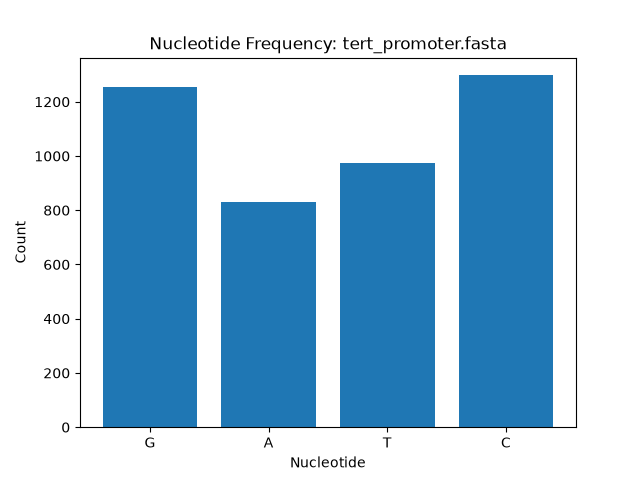

# AI and Python Journey

I am a final-year BS Biochemistry student transitioning into Data Analysis and AI Automation. This repository contains my foundational Python projects and my independent research tools.

## Featured Project: TERT Gene Promoter Analysis

**Title:** Nucleotide Composition and GC Content Analysis of the Human TERT Gene Promoter
**NCBI Accession:** AF097365.1

### Background
The TERT (Telomerase Reverse Transcriptase) gene promoter is a critical region for cellular aging and oncogenesis. Its regulation is heavily influenced by epigenetic modifications (DNA methylation), which occur primarily at CpG islands. A high GC content in the promoter indicates the presence of these islands. Furthermore, GC-rich regions present structural challenges for CRISPR-Cas9 genome editing efficiency.

### Tool Capabilities
This Python tool (`bio_analyzer.py`) analyzes FASTA sequences to provide:
- Nucleotide frequency counting (A, T, C, G)
- GC Content and AT Content calculation
- Codon frequency analysis
- Bar chart visualization of nucleotide composition

### Application and Results
Analyzing the human TERT promoter sequence yielded the following results:
- **Total Sequence Length:** 4356 bp
- **GC Content:** 58.59%
- **AT Content:** 41.41%
- **Most Frequent Codon:** GCC (56 times)

The high GC content (58.59%) confirms the presence of a CpG island in the TERT promoter. Biologically, this means the promoter is a hotspot for epigenetic regulation. From a CRISPR perspective, this high GC content indicates that standard Cas9 editing may face structural barriers, requiring high-fidelity enzymes or alternative targeting strategies.

---

## Other Foundational Projects

- **`lab_checker.py`**: A biochemistry lab result checker that validates patient Glucose, Cholesterol, and Hemoglobin levels against standard ranges.
- **`password_tool.py`**: A password generator and strength analyzer.
- **`grade_book.py`**: A student grade manager using lists, dictionaries, and JSON file persistence.
- **`employees.py`**: An employee database system with file persistence.

## Tech Stack
- Python 3
- Git & GitHub
- Matplotlib (Data Visualization)

## Future Goals
Moving on to SQL, Pandas, APIs, and AI integration.